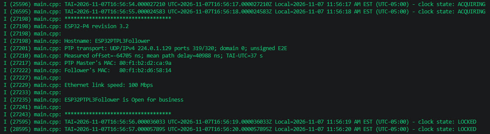

# ESP32PTPL3Follower (v1.0)

ESP32PTPL3Follower is a **Precision Time Protocol** (PTP) Master Clock **Layer 3** (L3) Multicast UDP **Follower**.

Which means its time synced to a PTP L3 Multicast UPD server with a degree of precision measured in 
Nanoseconds (ns) as opposed to a Network Time Protocol (NTP) server with a degree of 
precision measured in Microseconds (µs) (1 second = 1 million µs = 1 billion ns).

The program is designed to run on ESP32-P4 / ESP32-S31 development boards with Ethernet 
external physical layer (PHY) chips supporting hardware time stamping (please see
the `Supported hardware` section below for more information).

The code is build upon the ESP-IDF 6.1 platform without Arduino wrappers
or dependencies. 

It is a perfect companion for  [ESP32TimeServer](https://github.com/roblatour/ESP32TimeServer) an ESP32 based PTP and NTP Time Server.

- The program is designed as a demo / reusable template for other ESP32 development 
  projects wanting to leverage the accuracy of PTP time keeping,  
- ESP32PTPL3Follower supports keyless communications (i.e. no symmetric key id and value authorization - mirroring how Windows works in this regard).
- As PTP timekeeping is based on **TAI** (Temps Atomique International - French for 
  International Atomic Time) ESP32PTPL2Follower includes conversion routines to **UTC**
  (Coordinated Universal Time) and **local** time based on timezone and DST 
  conversions use the local POSIX timeZoneSpec rules. 
- The basic functionality of the program is to connect to (and stay connected to) 
  a PTP L3 UDP server and report its clock state and the TAI, UTC, and Local time every 
  second in the console log.

  >Notes: 
  >1. PTP L3 UDP Servers/Followers work differently than PTP L2 Servers/Followers.  In short, a PTP L3 UPD Server works with the Windows' compatible PTP L3 UDP Time Server implementations while a PTP L2 Follower works with Linux chrony compatible PTP L2 Time Server implementations.   
  >2. ESP32TimeServer as a server supports NTP, PTP L2, and PTP L3 UDP. This program is a PTP L3 UDP Follower, here is a link to a [PTP L2 Follower](https://github.com/roblatour/ESP32L2Follower). 
  >3. Neither type of PTP server or Follower will work across hardware firewall (such as OPNSense and PFSense) interfaces.  PTP Servers and Followers both need to be within the same interface.  This is not the case for NTP servers, which do work fine across interfaces.

## Example console log output

## Supported hardware

| Chip      | Development board                                                                                                                                              | Ethernet PHY                       |
| --------- | -------------------------------------------------------------------------------------------------------------------------------------------------------------- | ---------------------------------- |
| ESP32-P4  | [Waveshare ESP32-P4-ETH](https://docs.waveshare.com/ESP32-P4-ETH)                                                                                              | IP101 (RMII, 10/100 Mbit/s)        |
| ESP32-S31 | [Espressif ESP32-S31-Function-CoreBoard-1](https://docs.espressif.com/projects/esp-dev-kits/en/latest/esp32s31/esp32-s31-function-coreboard-1/user_guide.html) | YT8531 (RGMII, 10/100/1000 Mbit/s) |

There is a single code base. The ESP-IDF build target (`esp32p4` or `esp32s31`)
automatically selects the matching board wiring in
[ESP32PTPL2FollowerSettings.h](/main/ESP32PTPL2FollowerSettings.h) via
`CONFIG_IDF_TARGET_ESP32P4` / `CONFIG_IDF_TARGET_ESP32S31`; there is no chip
setting to edit. Any other target is rejected at build time. A firmware image
built for one chip will not run on the other.

Notes for the ESP32-S31:

- ESP32-S31 is a **preview target** in ESP-IDF v6.1, so `idf.py` needs the
  `--preview` option for it (the build helper adds it automatically).
- ESP32-S31 support is compile-verified; validation on the ESP32-S31-Function-CoreBoard-1
  hardware is pending.


## Software

## Build and development environment

Setting up ESP32PTPL3Follower requires ESP-IDF v6.1 be installed on your computer.
If you don't have this installed, please see the instructions at `Software` - `Build and development environment` section of on the [ESP32TimeServer Github homepage](https://github.com/roblatour/ESP32TimeServer)

## Setup 

### Setup Step 1 - Download

Create a folder for this project and clone this repository into it. For example:

```cmd
c:
```

```cmd
mkdir c:\temp\ESP32PTPL3UPDFollower
```

```cmd
cd \temp\ESP32PTPL3UPDFollower
```

```cmd
git clone --recursive https://github.com/roblatour/ESP32PTPL3UPDFollower
```

```cmd
cd ESP32PTPL3UPDFollower
```

## Setup Step 2 - Configure

ESP32PTPL3UPDFollowerSettings are configured in the 
[ESP32PTPL3FollowerSettings.h](/main/ESP32PTPL3UPDFollowerSettings.h) file.


## Setup Step 3 - Build ESP32PTPL3UPDFollower

3.1 The commands shown below should be run from an ESP-IDF v6.1 shell. 

To run from an ESP-IDF v6.1 shell, either enter the commands below from either:

a) the Visual Studio's terminal line with the Espressif ESP-IDF plug in installed, 

or 

b) for the Windows command / powershell prompt, from your workspace root directory, after having entered the following command:
```powershell
call C:\esp\v6.1\esp-idf\export.bat
```

Once you have setup the ESP-IDF v6.1 shell (above), you will need to know the type of ESP32 chip (ESP32-P4 or ESP32-S31) you have. Also, if you have an ESP32-P4 chip then you need to know its revision number.

If you're not sure which chip or revision a board has, run:
```powershell
python -m esptool -p COMx chip-id
```
( where `COMx` is the COM port it is connected to on your computer - for example `COM3` )

Next, build the project, to do this enter (as an example) the following command:

```powershell
python tools\build.py --profile pre_v3
```

Where the profile referenced above is one of the following:

| Profile  | Target    | Use for                                                          |
| -------- | --------- | ---------------------------------------------------------------- |
| `pre_v3` | ESP32-P4  | Waveshare ESP32-P4-ETH with chip revision below v3.0 (e.g. v1.3) |
| `v3_0`   | ESP32-P4  | Waveshare ESP32-P4-ETH with chip revision v3.0                   |
| `v3_1`   | ESP32-P4  | Waveshare ESP32-P4-ETH with chip revision v3.1                   |
| `s31`    | ESP32-S31 | Espressif ESP32-S31-Function-CoreBoard-1                         |

Each profile builds into its own `build_<profile>` folder.


The equivalent raw `idf.py` command for the ESP32-S31 is:

```powershell
idf.py --preview -B build_s31 -D SDKCONFIG=build_s31\sdkconfig -D "SDKCONFIG_DEFAULTS=sdkconfig.defaults;config\esp32s31_function_coreboard_1.defaults" set-target esp32s31 build
```

## Setup Step 4 - Flash and monitor

From the workspace root enter (using the build folder of the profile you built):

ESP32-P4 (for example with the 1.3 chip revision):

```powershell
idf.py -B build_pre_v3 -p COMx flash monitor
```

ESP32-S31:

```powershell
idf.py --preview -B build_s31 -p COMx flash monitor
```

On the ESP32-S31-Function-CoreBoard-1 either the USB-to-UART or the USB Serial/JTAG
Type-C port can be used; if automatic download mode fails, hold **BOOT** and
press **Reset**.


---

## License

This project is released under the **MIT License** — see the [LICENSE](LICENSE)
file for details.

---

## Supporting This Project

To help support this project, or to just say thanks, you're welcome to 'buy me a
coffee'.

[](https://www.buymeacoffee.com/roblatour)

---

Copyright © 2026 Rob Latour

